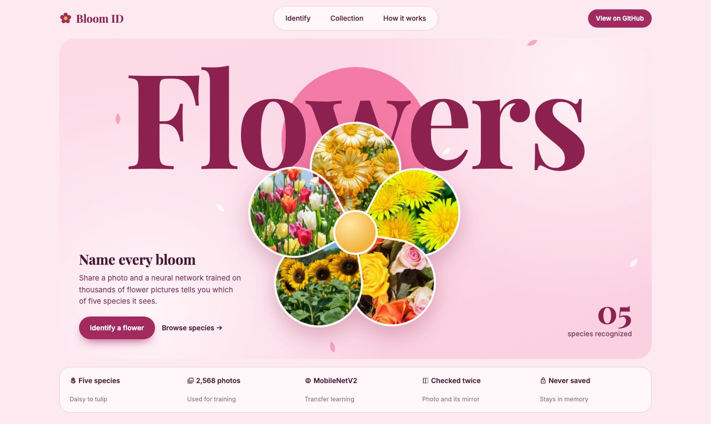
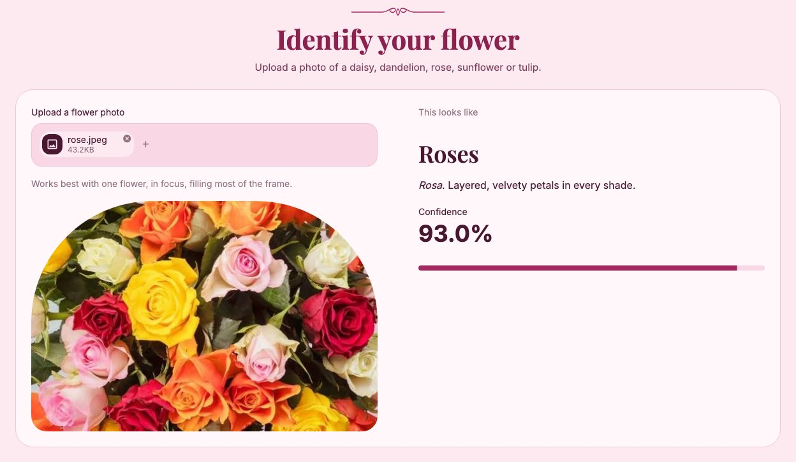
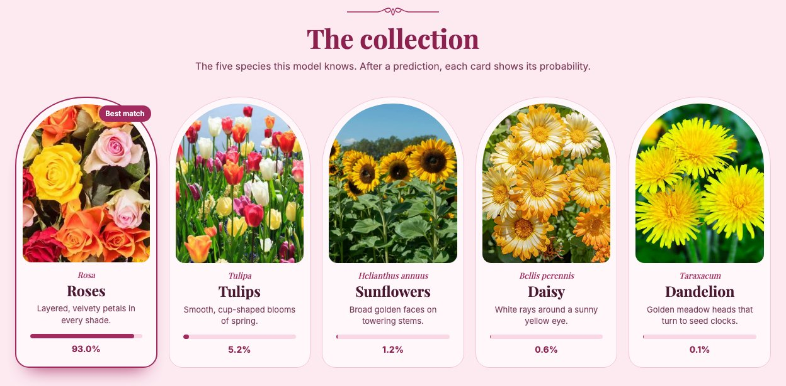
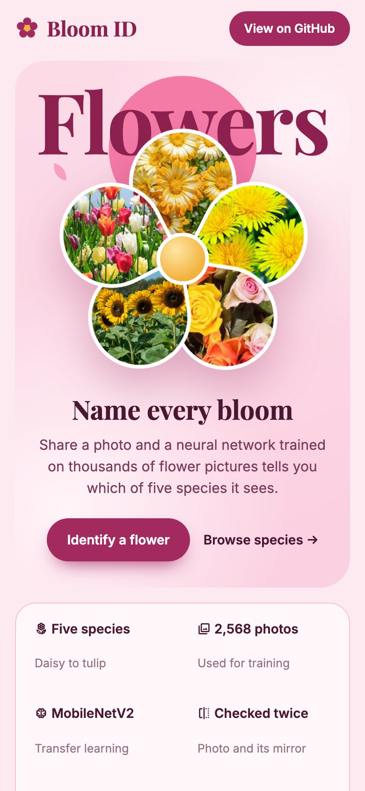
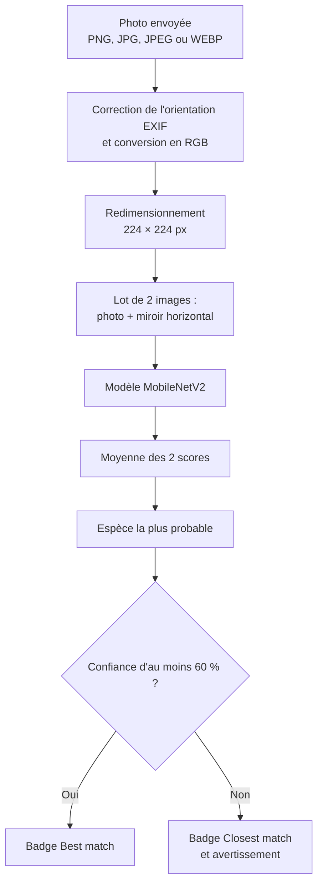
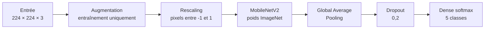
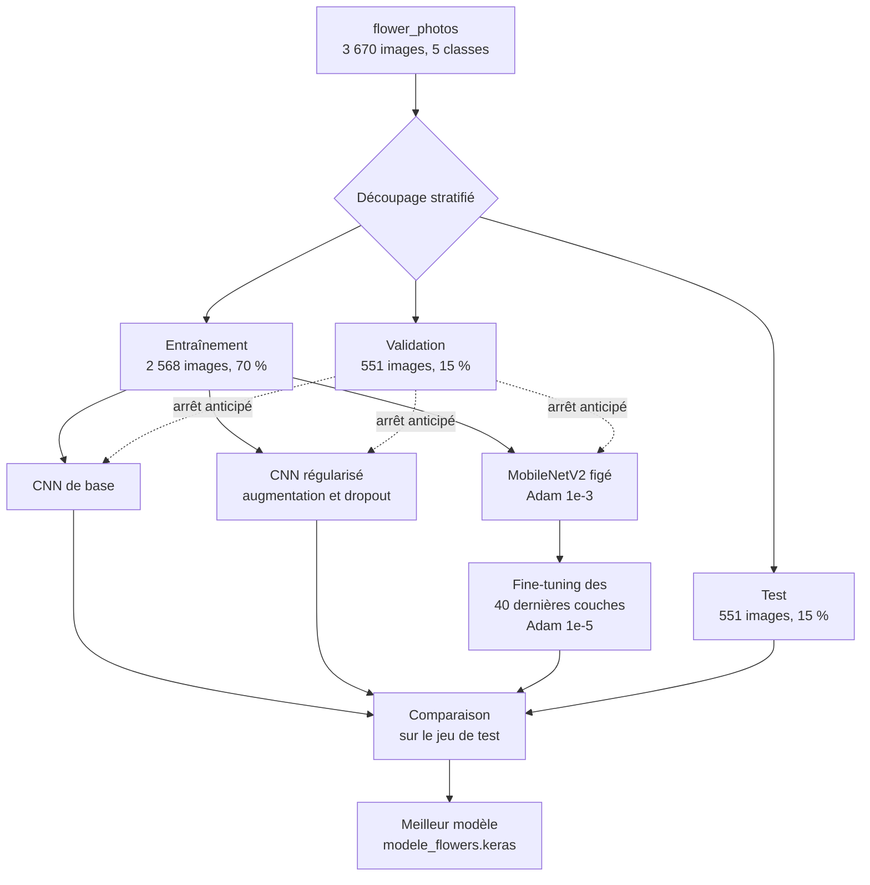
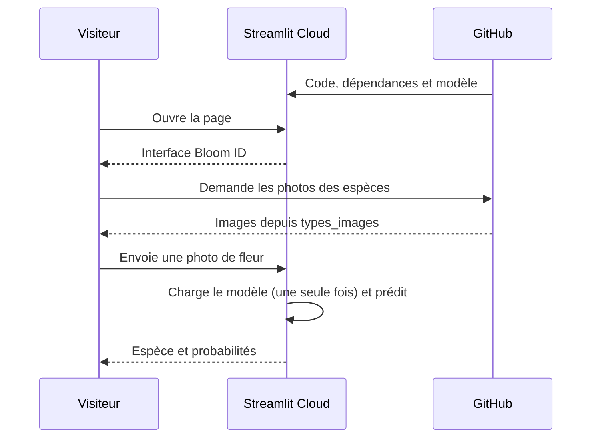

# Bloom ID

Application web qui reconnaît une fleur à partir d'une photo. Un réseau de neurones entraîné par transfert d'apprentissage classe l'image parmi cinq espèces : marguerite, pissenlit, rose, tournesol et tulipe.

**[Essayer l'application en ligne](https://framwork-deep-learning-hrmjp52vtw3vzt8wvektqu.streamlit.app/)**



## Sommaire

- [Captures d'écran](#captures-décran)
- [Fonctionnement d'une prédiction](#fonctionnement-dune-prédiction)
- [Le modèle](#le-modèle)
- [Entraînement](#entraînement)
- [Structure du projet](#structure-du-projet)
- [Lancer le projet en local](#lancer-le-projet-en-local)
- [Déploiement](#déploiement)
- [Limites](#limites)

## Captures d'écran

### Résultat d'une prédiction

L'application affiche la photo envoyée, l'espèce trouvée et le niveau de confiance.



### Probabilités par espèce

Après une prédiction, les cartes se classent de la plus probable à la moins probable.



### Version mobile



## Fonctionnement d'une prédiction

La photo et son image miroir passent toutes les deux dans le modèle, puis les deux scores sont moyennés. Sous 60 % de confiance, l'application prévient que le résultat est incertain.



## Le modèle

Le fichier `modele_flowers.keras` contient un MobileNetV2 pré-entraîné sur ImageNet, suivi d'une petite tête de classification. Il compte 2 264 389 paramètres et intègre sa propre normalisation : il reçoit donc des pixels bruts entre 0 et 255.



## Entraînement

Tout l'entraînement se trouve dans le notebook [`TP_CNN_Flowers (3).ipynb`](<TP_CNN_Flowers (3).ipynb>). Les données proviennent du jeu public `flower_photos` de TensorFlow.

| Espèce | Classe du modèle | Images |
|---|---|---:|
| Marguerite | `daisy` | 633 |
| Pissenlit | `dandelion` | 898 |
| Rose | `roses` | 641 |
| Tournesol | `sunflowers` | 699 |
| Tulipe | `tulips` | 799 |
| **Total** | | **3 670** |



**Résultats :** le CNN de base atteint 80,6 % de précision et un F1 macro de 80,4 % sur les 551 images de test. Le notebook retient ensuite le meilleur des trois modèles, et le fichier sauvegardé est bien un MobileNetV2. Les scores de cette comparaison finale ne sont pas conservés dans le notebook : la précision du modèle déployé n'est donc pas indiquée ici.

## Structure du projet

```text
.
├── streamlit_cnn.py            Application Streamlit
├── modele_flowers.keras        Modèle entraîné
├── requirements.txt            Dépendances utilisées au déploiement
├── TP_CNN_Flowers (3).ipynb    Préparation des données et entraînement
├── .streamlit/config.toml      Thème : couleurs, polices, arrondis
├── assets/style.css            Styles de la page
├── types_images/               Photos des cinq espèces
└── docs/screenshots/           Captures de ce README
```

## Lancer le projet en local

Le projet se lance avec **Python 3.12**.

```bash
git clone https://github.com/toubani12/framwork-deep-learning.git
cd framwork-deep-learning
python3.12 -m venv venv
source venv/bin/activate    # Windows : venv\Scripts\activate
```

Sur Linux ou Windows :

```bash
pip install -r requirements.txt
```

Sur Mac Apple Silicon, où `tensorflow-cpu` n'est pas disponible :

```bash
pip install streamlit==1.66.1 tensorflow==2.21.0 keras==3.15.1 numpy pillow
```

Puis, sur tous les systèmes :

```bash
streamlit run streamlit_cnn.py
```

## Déploiement

L'application est hébergée sur Streamlit Community Cloud. Le code et le modèle viennent de GitHub, et le navigateur charge directement depuis GitHub les photos des espèces.



Pour déployer votre propre copie :

1. Sur [share.streamlit.io](https://share.streamlit.io), choisissez **Create app**.
2. Sélectionnez le dépôt, la branche `main` et le fichier `streamlit_cnn.py`.
3. Dans **Advanced settings**, choisissez **Python 3.12**. `tensorflow-cpu==2.21.0` n'existe pas pour Python 3.14.

> [!IMPORTANT]
> Gardez un `requirements.txt` court. Un `pip freeze` complet peut contenir une ligne `-e file:///...` propre à votre machine, et l'installation échoue alors sur Streamlit Cloud.

Si vous renommez le dépôt, mettez aussi à jour `IMAGE_BASE_URL` et `REPO_URL` dans `streamlit_cnn.py`, car les photos sont chargées depuis cette adresse.

## Limites

- Le modèle ne connaît que ces cinq espèces : toute autre fleur sera associée à l'espèce la plus proche.
- Une confiance élevée ne garantit pas que la réponse soit juste, surtout si la photo montre plusieurs fleurs ou un fond chargé.
